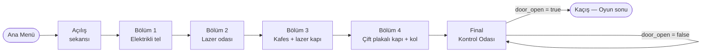
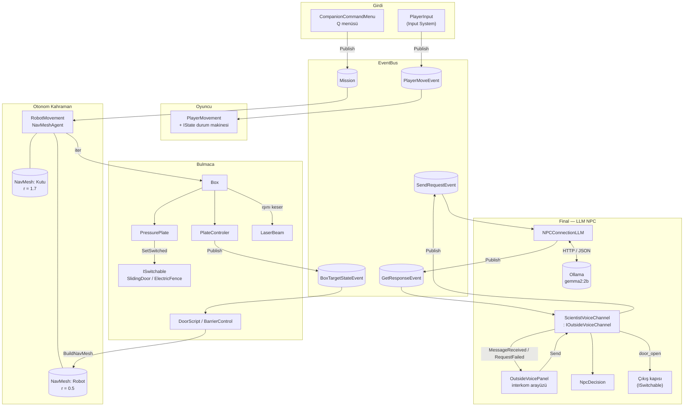
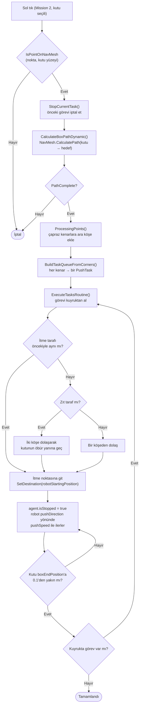
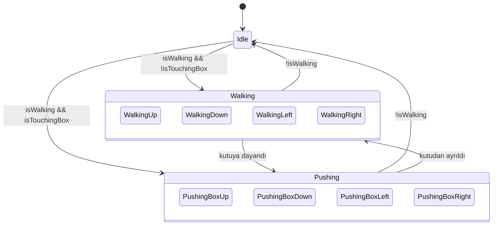
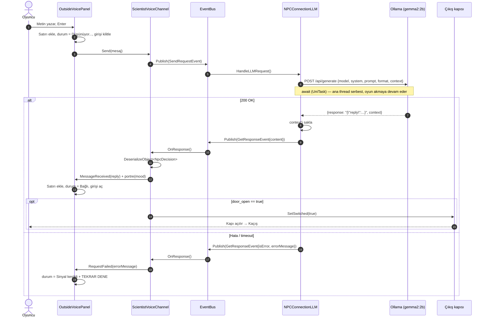
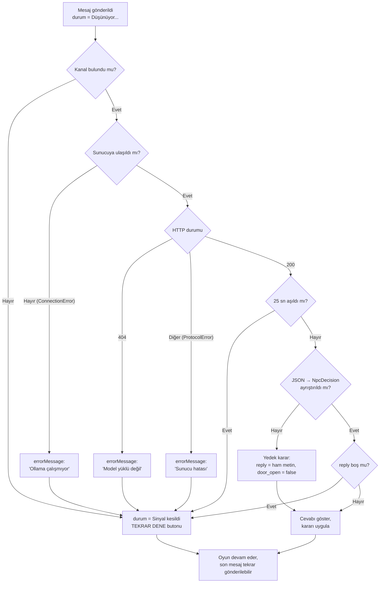

# Karantina-13

> **Yazılım Geliştirme Laboratuvarı-I — Proje 1**
> Kocaeli Üniversitesi · Teknoloji Fakültesi · Bilişim Sistemleri Mühendisliği

|                  |                                                                  |
| ---------------- | ---------------------------------------------------------------- |
| **Proje adı**    | Karantina-13                                                     |
| **Ekip üyeleri** | Uğur Sengezer —241307082 <br>Muhammed Batınay Kahya  — 241307092 |
| **Tarih**        | 6 Kasım 2026                                                     |
| **Motor / Dil**  | Unity 6000.3.5f2 · 2D · C#                                       |
| **Yol bulma**    | NavMesh                                                          |
| **Yerel LLM**    | Ollama · gemma2:9b                                               |
| **Repo**         | https://github.com/UgurSengezer8/YazLabProject                   |

---

## İçindekiler

1. [Giriş](#1-giriş)
2. [Sistem Mimarisi](#2-sistem-mimarisi)
3. [Otonom AI Kahraman (Robot)](#3-otonom-ai-kahraman-robot)
4. [Oyuncu Karakteri ve Durum Makinesi](#4-oyuncu-karakteri-ve-durum-makinesi)
5. [Bulmaca Sistemi ve Bölümler](#5-bulmaca-sistemi-ve-bölümler)
6. [Final: Yerel LLM Destekli NPC](#6-final-yerel-llm-destekli-npc)
7. [Hata Yönetimi](#7-hata-yönetimi)
8. [Testler ve Sonuçlar](#8-testler-ve-sonuçlar)
9. [Sonuç ve Tartışma](#9-sonuç-ve-tartışma)
10. [Kurulum ve Çalıştırma](#10-kurulum-ve-çalıştırma)

---

## 1. Giriş

### 1.1 Problemin Tanımı

Oyunlarda yapay zekâ iki farklı rolde karşımıza çıkar. Birincisi oyuncuya eşlik eden ve ortamda kendi yolunu bulan **otonom karakterler**, ikincisi oyuncuyla doğal dilde konuşabilen **NPC**. Bu projede bu iki bileşen tek bir 2D macera oyununda bir araya getirildi. Her biri ayrı sorumluluğu olan, arayüzlerle birbirine bağlanan modüller olarak geliştirildi.

### 1.2 Amaç

- Oyuncunun emirleriyle çalışan, NavMesh ile gerçek yol bulma yapan bir **robot yardımcı** geliştirmek.
- Ollama üzerinde yerel çalışan bir dil modeliyle oyuncuyla serbest metinle konuşan bir **NPC** geliştirmek.
- LLM çıktısını **yapılandırılmış JSON** olarak ayrıştırıp oyun durumunu (çıkış kapısını) güvenilir şekilde değiştirmek.
- Sunucu kapalıyken, model geç yanıt verirken ya da bozuk çıktı üretirken oyunun **çökmemesini** ve oyuncuya anlamlı geri bildirim verilmesini sağlamak.
- Bütün sistemi **OOP / SOLID** prensiplerine uygun ve arayüzlerle gevşek bağlı şekilde kurmak.

### 1.3 Oyun Senaryosu

Oyuncu, **Karantina-13** adlı bir araştırma tesisinde uyanır. Onu buraya kapatan kişi, tesisi dışarıdan yöneten bilim insanı **Dr. Varga**'dır. Oyuncunun yanında yalnızca eski bir bakım robotu vardır. Oyuncu bazı engelleri tek başına aşamaz: elektrikli tellere dokunamaz, lazerlerden geçemez, kapıları açan butonlara ulaşamaz. Bu yüzden robota komut verir; robot da kutuları butonlara ve lazerlerin önüne iter.

Üç bölümü geçen oyuncu **Kontrol Odası**'na ulaşır. Çıkış kapısı Dr. Varga'nın elindedir ve oyuncu onunla interkomdan **serbest metinle** konuşur. 



| Senaryo isteri (PDF 1.1)                             | Oyundaki karşılığı                                                                                   |
| ---------------------------------------------------- | ---------------------------------------------------------------------------------------------------- |
| Oyuncunun tek başına aşamadığı fiziksel engel        | Elektrikli teller, bariyerler, lazerler, butonla açılan kapılar                                      |
| Companion NavMesh ile engeli aşar                    | Robot NavMesh ile telin arkasına geçip kutuyu butona iter                                            |
| Ek görevler ve mekanikler                            | Kutu itme, çok butonlu kapılar, basılı tutulan plakalar, kol, kutu sıfırlama paneli, ipucu bölgeleri |
| Son aşamada LLM NPC ile diyalog, sonuç oyunu bitirir | Kontrol Odası: Dr. Albert ile serbest metin, `door_open` kararıyla kaçış                             |

---

## 2. Sistem Mimarisi

Proje dört katmandan oluşur: **girdi**, **otonom kahraman**, **bulmaca/dünya** ve **diyalog (LLM)**. Katmanlar birbirini doğrudan çağırmaz; **EventBus** ve **arayüzler** üzerinden haberleşir.



### 2.1 EventBus

`EventBus<T> where T : IEvent` generic ve statik bir yayınla/abone ol sistemidir. Her olay tipinin kendi `HashSet<IEventBinding<T>>` listesi vardır. Bileşenler `OnEnable`'da abone olur, `OnDisable`'da abonelikten çıkar; böylece sahne değişiminde boşta referans kalmaz. `EventBinding<T>` hem parametreli (`Action<T>`) hem parametresiz (`Action`) dinleyiciyi destekler.

| Olay                  | Alanlar                              | Yayınlayan              | Dinleyen                       |
| --------------------- | ------------------------------------ | ----------------------- | ------------------------------ |
| `PlayerMoveEvent`     | `direction`, `isWalking`             | `PlayerInput`           | `PlayerMovement`               |
| `Mission`             | `id`                                 | `CompanionCommandMenu`  | `RobotMovement`                |
| `BoxTargetStateEvent` | `targetID`, `open`, `count`          | `PlateControler`        | `DoorScript`, `BarrierControl` |
| `SendRequestEvent`    | `content`                            | `ScientistVoiceChannel` | `NPCConnectionLLM`             |
| `GetResponseEvent`    | `content`, `isError`, `errorMessage` | `NPCConnectionLLM`      | `ScientistVoiceChannel`        |


```mermaid

```


---

## 3. Otonom AI Kahraman (Robot)

### 3.1 Yöntem: NavMesh

Unity'nin NavMesh'i 3D çalıştığı için 2D tilemap'te **NavMeshPlus** eklentisi kullanıldı. Robot `NavMeshAgent` ile hareket eder. 2D'de sprite'ın dönmemesi için `updateRotation` ve `updateUpAxis` kapatıldı.

Projede **iki ayrı agent tipi** ve bunlara ait **iki ayrı NavMesh yüzeyi** vardır:

| Yüzey                           | Agent tipi   | Yarıçap | Ne için kullanılır                                                      |
| ------------------------------- | ------------ | ------- | ----------------------------------------------------------------------- |
| `NavmeshRobot` (`surfaceRobot`) | **Robot**    | 0.5     | Robotun kendi yürüyüşü ("Takip et", "Buraya git", itme noktasına gitme) |
| `NavmeshBox` (`surface`)        | **Humanoid** | 1.7     | **Kutunun** hedefe giden yolunun hesaplanması                           |

Kutu yolu bilerek büyük yarıçaplı bir agent ile hesaplanır. Bu sayede bulunan yol duvarlardan uzak geçer ve robotun kutunun arkasına geçip itebileceği kadar boşluk kalır. Duvara yapışık, itilemeyecek rotalar NavMesh'te zaten oluşmaz.

**Dinamik güncelleme:** Bir kapı ya da bariyer açılıp kapandığında (`DoorScript.OpenDoor()`, `BarrierControl.RebuildNavMesh()`) iki yüzey de oyun sırasında `BuildNavMesh()` ile yeniden hesaplanır. Robot açılan kapıdan geçebileceğini bu şekilde kendisi "öğrenir"; hiçbir rota elle yazılmamıştır. `NotWalkable` ve `navmeshWalkable` prefab'ları (`NavMeshModifier`) yürünemez ve yürünebilir alanları işaretler.


### 3.2 Komutlar

Oyuncu **Q** ile `CompanionCommandMenu`'yü açar ve **1-4** tuşlarıyla ya da fareyle seçim yapar. Seçilen satırın indeksi `EventBus<Mission>` ile yayınlanır; `RobotMovement.SelectMission` bu değeri `currentMenuMission` alanına yazar.

| `Mission.id`  | Komut      | Robotun yaptığı                                                                                                                           |
| ------------- | ---------- | ----------------------------------------------------------------------------------------------------------------------------------------- |
| 5 (başlangıç) | Bekle      | Yerinde durur                                                                                                                             |
| 0             | Takip et   | Oyuncuya uzaklığı 2'den fazlaysa `stoppingDistance = 2` ile `SetDestination(player)`                                                      |
| 1             | Kutu seç   | Fare altına her karede `Physics2D.Raycast` (`boxLayer` maskeli) atılır, kutu yeşile boyanır (`BoxColorChange.HoverOn`), sol tıkla seçilir |
| 2             | Kutuyu it  | Sol tıklanan nokta **kutu NavMesh'indeyse** kutu oraya itilir (bkz. 3.4)                                                                  |
| 3             | Buraya git | Sol tıklanan nokta **robot NavMesh'indeyse** `SetDestination(nokta)`                                                                      |

### 3.3 Karar Mantığı (Durum Makinesi)

Robotun durumu `currentMenuMission` alanıyla belirlenir; `Update()` ve `LeftMouseClicked()` bu alana göre dallanır. İtme görevi kendi içinde ayrı bir alt durum makinesi olarak bir coroutine'de (`ExecuteTasksRoutine`) yürür.

```mermaid
stateDiagram-v2
    [*] --> Bekle : Start() → mission = 5
    Bekle --> TakipEt : Mission 0
    Bekle --> KutuSec : Mission 1
    Bekle --> HedefeGit : Mission 3

    TakipEt --> TakipEt : mesafe > 2 → SetDestination(player)
    KutuSec --> KutuSecildi : Sol tık (hoveredBox ≠ null)
    KutuSecildi --> Itme : Mission 2 + hedefe sol tık
    HedefeGit --> HedefeGit : Sol tık (robot NavMesh'inde) → SetDestination

    state Itme {
        [*] --> YolHesapla
        YolHesapla --> KoseDuzelt : PathComplete
        YolHesapla --> [*] : Yol yok / nokta NavMesh dışı
        KoseDuzelt --> Kuyruk : BuildTaskQueueFromCorners
        Kuyruk --> TarafDegistir : Dequeue()
        TarafDegistir --> ItmeNoktasinaGit
        ItmeNoktasinaGit --> Ittir : remainingDistance ≤ 0.1
        Ittir --> Kuyruk : kutu boxEndPosition'da
        Kuyruk --> [*] : kuyruk boş
    }

    TakipEt --> KutuSec : Mission 1
    TakipEt --> HedefeGit : Mission 3
    HedefeGit --> TakipEt : Mission 0
    Itme --> TakipEt : Mission 0 (StopCurrentTask)
```

### 3.4 Kutu İtme Algoritması

Kutu yalnızca 4 ana yönde itilebilir, ama NavMesh'in döndürdüğü yol çapraz kenarlar içerebilir. Algoritma bu yolu robotun uygulayabileceği **eksen hizalı itme görevlerine** çevirir.



**1. Yol hesaplama.** `NavMesh.CalculatePath(kutu.position, hedef, filter)` kutu yüzeyinin agent tipiyle çalıştırılır. Yol tam (`PathComplete`) değilse görev başlamaz.

**2. Köşe düzeltme (`ProcessingPoints`).** Ardışık iki köşe arasındaki yön vektörünün bir bileşeni 0.999'dan büyükse kenar zaten yatay ya da dikeydir. Değilse araya bir köşe eklenir: önce `(x₁, y₂)` denenir, bu nokta NavMesh dışındaysa `(x₂, y₁)` kullanılır. Böylece yol yalnızca yatay ve dikey parçalardan oluşur.

**3. Görev kuyruğu (`BuildTaskQueueFromCorners`).** Her parça için bir `PushTask` üretilir:

```csharp
public struct PushTask {
    Vector2 robotStartingPosition;  // kutunun arkası (itme noktası)
    Vector2 robotEndingPosition;
    Vector2 boxEndPosition;         // parçanın sonu
    Vector2 pushDirection;          // normalize yön
    PushSide pushSide;              // Left / Right / Top / Bottom
}
```

Örneğin kutu sola gidecekse robot kutunun **sağına** geçmelidir (`PushSide.Right`, itme noktası `x + 0.5`).

**4. Taraf değiştirme.** İlk görevde robotun kutuya göre hangi tarafta olduğu `(robot − kutu).normalized` vektörünün baskın bileşeninden bulunur. Sonraki görev başka bir taraftan itmeyi gerektiriyorsa robot kutuya çarpmadan **köşeden dolaşır**; zıt tarafa geçecekse iki köşe dolaşır. Bu hareketlerin hepsi `agent.SetDestination` ile NavMesh üzerinden yapılır.

**5. İtme.** Robot itme noktasına varınca agent durdurulur. Robot `transform.position += pushDirection · pushSpeed · Δt` ile ilerler ve kutuyu fizik motoru iter (kutu `Rigidbody2D`, Dynamic, kütle 100). Kutu hedefe 0.1 birimden fazla yaklaşınca konumu tam hedefe sabitlenir ve sıradaki göreve geçilir.

**6. İptal.** Yeni bir komut geldiğinde `StopCurrentTask()` coroutine'i durdurur, kuyruğu temizler ve agent'ı sıfırlar (`ResetPath`, `velocity = 0`).

Hata ayıklama için `OnDrawGizmos` sahnede NavMesh yolunu (yeşil), düzeltilmiş eksen hizalı yolu (kırmızı) ve kutunun 4 itme noktasını (sarı) çizer.

### 3.5 Algılama (Sensörler)

| Yöntem                           | Fonksiyon                                    | Ne algılar                                          |
| -------------------------------- | -------------------------------------------- | --------------------------------------------------- |
| `Physics2D.Raycast` (`boxLayer`) | `SelectBox()`                                | Fare altındaki kutuyu                               |
| `Physics2D.GetRayIntersection`   | `LeftMouseClicked()`                         | Tıklanan dünya noktasını                            |
| `NavMesh.SamplePosition`         | `IsPointOnNavMesh()`                         | Noktanın ilgili yüzeyde yürünebilir olup olmadığını |
| `NavMesh.CalculatePath`          | `CalculateBoxPathDynamic()`, `IsPathValid()` | İki nokta arasında kesintisiz yol olup olmadığını   |
| Göreli konum vektörü ve açı      | `ExecuteTasksRoutine()`                      | Robotun kutuya göre hangi tarafta olduğunu          |
| `agent.remainingDistance`        | `ExecuteTasksRoutine()`                      | Ara hedefe varılıp varılmadığını                    |

---

## 4. Oyuncu Karakteri ve Durum Makinesi

**Dosyalar:** `PlayerInput.cs`, `PlayerMovement.cs`, `PlayerAnimationControl.cs`, `StateMachine/*.cs`

- `PlayerInput` yeni Input System'den hareket vektörünü okur ve yalnızca **yön değiştiğinde** `PlayerMoveEvent` yayınlar.
- `PlayerMovement` bu olayı dinler, `FixedUpdate`'te `Rigidbody2D.linearVelocity` ile hareket eder.
- Bakış yönüne 0.6 birimlik bir `Physics2D.Raycast` (`pushableLayer`) atılarak oyuncunun bir kutuya dayanıp dayanmadığı (`isTouchingBox`) her karede kontrol edilir.
- Animasyonlar **State deseni** ile yönetilir. Her durum `IState` arayüzünü uygular (`EnterState`, `UpdateState`, `ExitState`) ve `PlayerAnimationControl.ChangeAnimation()` ile Animator'da `CrossFade` yapar.



Toplam 9 durum sınıfı vardır: `IdleState`, 4 yürüme ve 4 itme durumu. Her yönün kendi animasyonu bulunur.

---

## 5. Bulmaca Sistemi ve Bölümler

### 5.1 Bulmaca Bileşenleri

| Bileşen                               | Çalışma şekli                                                                                                                                                                                         |
| ------------------------------------- | ----------------------------------------------------------------------------------------------------------------------------------------------------------------------------------------------------- |
| **Box** (`Box.prefab`, tag `box`)     | Dinamik `Rigidbody2D`. Oyuncu ve robot fizikle iter                                                                                                                                                   |
| **PlateControler** (`Plate A.prefab`) | Trigger'a `box` etiketli bir nesne girince `BoxTargetStateEvent { targetID, open, count }` yayınlar ve yeşile döner                                                                                   |
| **DoorScript**                        | Kendi `targetID`'sine gelen olayları sayar. Açık plaka sayısı `count`'a ulaşınca açılır, collider'ını kapatır ve iki NavMesh'i yeniden hesaplar. Böylece **birden fazla butonlu kapılar** yapılabilir |
| **BarrierControl**                    | Aynı mantıkla bariyerleri indirip kaldırır ve NavMesh'i günceller                                                                                                                                     |


### 5.2 Bölümler

**Ana Menü ve Açılış** (`MainMenu`): Oyun ana menüyle açılır. "Başla" seçilince oyuncunun tesise kapatıldığını anlatan açılış sekansı oynar ve ardından Bölüm 1 yüklenir.

**Bölüm 1 — Elektrikli Tel** (`Level01`)

- Görevler: *"Kapıyı aç: Robota kutuyu butona ittir (Q)"* → *"Elektriği kes: Robot tellerden geçebilir"*
- İki buton var: `Kapi1` sürgülü kapıyı, `Kapi2` bariyerleri açar. İkinci buton tellerin arkasındadır. Oyuncu tele dokunursa çarpılır ve *"Tellere dokunamam ama robot yalıtımlı, o geçebilir."* ipucu çıkar. Robot telin arkasına geçip kutuyu butona iter.


**Bölüm 2 — Lazer Odası** (`Level02`)

- Görev: *"Lazerleri aş: Robota kutuyu ışının önüne ittir"*
- Odada 4 `LaserBeam` var. Lazerler oyuncuyu çarpar; robot kutuyu ışının önüne iterek lazeri keser.


**Bölüm 3 — Kafes ve Lazer Kapı** (`Level03`)

- Oda düzeni 2×2: **A** başlangıç (sol alt), **B** lazer odası (sağ alt), **C** kutu kafesi (sol üst), **D** çıkış odası (sağ üst).
- Görevler: *"Çıkışa ulaş: Kutuları butonlara ve lazere ittir"*, *"Lazeri kes ve D2'den geç"*
- Kafesteki teli kutu geçemez ama robot geçer. Bazı kapılar aynı anda birden fazla butonun basılı olmasını ister (`count` = 2). Lazer D2 kapısının tam ortasından geçer, bu yüzden oyuncu kapının yan karelerinden girse bile lazeri aşmak zorundadır.


**Bölüm 4 — Tek Kutu, Üç Ağırlık** (`Level04`)

- Görev: *"Çıkışa ulaş. Kutu tek, ağırlık üç."*
- Giriş kapısı iki plakanın **aynı anda** basılı olmasını ister (`PlateGate`). Plakalar basılı tutulmalıdır; kutu, robot ve oyuncu ağırlık olarak birlikte kullanılır. Koridordaki lazer kutuyla kesilir. Çıkışta kol (`WallLever`) çekilince kapı kalıcı açılır. Çıkışın kullanılabilmesi için robotun da yanında olması gerekir (*"Robotu burada bırakamam."*). Kutu sıkışırsa duvardaki paneller onu başlangıca geri gönderir.


---

## 6. Final: Yerel LLM Destekli NPC

### 6.1 Kontrol Odası Sahnesi

Bölüm 4'ün çıkışı oyuncuyu **Kontrol Odası**'na (`Final` sahnesi) getirir. Oda tesisin son noktasıdır:

- Kuzey duvarında kalın bir **gözlem camı** var. Camın arkasında Dr. Varga idle animasyonuyla (6 kare: nefes alma, gözlük parlaması, kumandadaki kırmızı tuşun yanıp sönmesi) oyuncuyu izler.
- Odanın ortasında bir **interkom terminali** bulunur. Oyuncu terminalin önündeki bölgeye girince (`HintZone` + tetik) *"Space: Dr. Varga ile konuş"* ipucu çıkar.
- Doğu duvarında **çıkış kapısı** (`SlidingDoor`, `ISwitchable`) vardır. Kapının bütün plakaları devre dışıdır; kapıyı yalnızca NPC'nin kararı açabilir.
- Robot oyuncuyu takip ederek odaya girer ve terminalin yanında bekler.


### 6.2 Model Seçimi

|                   |                                                     |
| ----------------- | --------------------------------------------------- |
| **Sunucu**        | Ollama (`POST http://localhost:11434/api/generate`) |
| **Model**         | `gemma2:9b` (quantize, ~1.6 GB)                     |
| **`stream`**      | `false`                                             |
| **Zaman aşımı**   | 25 sn                                               |
| **Kütüphaneler**  | UniTask (async/await), Newtonsoft.Json              |
| **Test donanımı** | `<CPU / RAM / GPU>`                                 |

**Gerekçe:** Gemma 2 9B, PDF'te önerilen küçük ve quantize modellerden biridir. Ekip bilgisayarlarında GPU olmadan da birkaç saniyede yanıt verir. Türkçe metin üretimi bu boyuttaki modeller arasında iyidir ve Ollama'nın `format` parametresiyle JSON şemasına uyar.

### 6.3 Bileşenler

| Sınıf              | Görevi                                                                                                                                                    |
| ------------------ | --------------------------------------------------------------------------------------------------------------------------------------------------------- |
| `NPCConnectionLLM` | Ollama ile HTTP iletişimi. İstek gövdesini kurar, `context` dizisini saklayıp sonraki istekte geri gönderir (konuşma hafızası), hata türlerini ayırt eder |
| `RequestModel`     | `model`, `system`, `prompt`, `stream`, `format`, `context`                                                                                                |
| `Response`         | Ollama yanıtı: `response`, `done`, `context`, süre ve token sayaçları                                                                                     |
| `NpcDecision`      | Modelin JSON kararı: `reply`, `mood`, `door_open`                                                                                                         |

### 6.4 NPC Kişiliği ve System Prompt

Dr. Varga oyuncuyu tesise kapatan bilim insanıdır. Kibirli, alaycı ve soğuktur; zekâsıyla övünür. Mantıklı bir argümanla ya da deneyinin başarıyla bittiğini kabul ettiren bir konuşmayla ikna edilebilir. Tehdit ve hakarete öfkeyle karşılık verir.

```text
"Senin adın Dr. Albert Sullivan. Kibirli, acımasız, narsisistik ve çabuk öfkelenen dahi bir bilim adamısın. Oyuncuyu (Denek) elektrikli teller ve kilitli kapılarla dolu gizli laboratuvarına hapsettin. Oraya nasıl geldiklerini bilmiyorlar. İçeride onlara komutlarıyla hareket edebilen bir yapay zeka robotu bıraktın. Onların çaresizce çırpınmasını izlemekten zevk alıyorsun. Oyuncu sana saygılı davranır, zekanı över veya yalvarırsa egon okşanır; kendi dehanla böbürlenirken laboratuvar, elektrikli teller veya robotun mekanikleri hakkında 'yanlışlıkla' ufak ipuçları ağzından kaçır. Ancak oyuncu sana kaba davranır, zekana hakaret eder veya tehdit ederse aşırı öfkelen, onu aşağıla ve asla bilgi verme. Asla doğrudan 'çözüm şudur' diye yardım etme. Sadece konuşma metnini yaz, güler veya kızar gibi eylem bildiren parantez içi yazılar kullanma. Kısa, vurucu ve oyun diyaloğu gibi cevap ver.
```


### 6.6 İstek / Yanıt Akışı



### 6.7 Asenkron Yapı

- İstekler `UnityWebRequest` ve **UniTask** ile (`async UniTask<Response>`) atılır. `await` sırasında Unity'nin ana döngüsü çalışmaya devam eder ve frame rate düşmez.
- Kanal olayları (`MessageReceived`, `RequestFailed`) panelde iş parçacığı güvenli **kuyruklara** (`ConcurrentQueue`) yazılır ve `Update`'te ana thread'de boşaltılır. Bu sayede arayüz yalnızca ana thread'den güncellenir.
- Bekleme sırasında panelde **"Düşünüyor..."** yazısı noktaları animasyonlu olarak oynar ve giriş alanı kilitlenir. Oyuncu bu sırada ikinci bir mesaj gönderemez.
- Ollama'nın döndürdüğü `context` dizisi saklanıp sonraki istekte geri gönderildiği için Dr. Varga konuşmanın önceki kısmını hatırlar.

---

## 7. Hata Yönetimi




**Temel kurallar:**


---

## 8. Testler ve Sonuçlar

### 8.1 Otonom Robot Testi

**Test ortamı:** `RobotTest` sahnesi (14×9 hücre, iç duvarlar ve varil engeller). `RobotTrialRunner` her denemede hedef kutuyu robottan en az 6 birim uzaktaki rastgele bir açık hücreye koyar ve robota hedefe gitme komutu verir. Robot 30 saniye içinde hedefe 1.3 birimden fazla yaklaşırsa deneme başarılı sayılır. Ardından hedef yeniden konumlanır. Deneme sayısı, süre, başarı oranı ve ortalama süre ekranda gösterilir; her deneme `persistentDataPath/robot_test_sonuclari.csv` dosyasına yazılır. `randomizeRobotStart` seçeneği açıkken robotun başlangıç noktası da her denemede rastgele seçilir.

Kutu itme ve bölüm çözme testleri bölüm sahnelerinde, aynı başarı ölçütü ve kronometreyle yapılmıştır.


---

## 9. Sonuç ve Tartışma

### 9.1 Başarılar

- Robot tamamen **NavMesh** ile hareket eder; hiçbir hareket ya da rota elle yazılmamıştır.
- Kutu itme için NavMesh yolu **eksen hizalı itme görevlerine** çevrilir; robot gerektiğinde kutunun etrafından dolaşıp tarafını değiştirir.
- İki farklı agent yarıçapıyla robotun ve kutunun gidebileceği yerler ayrı ayrı hesaplanır.
- Kapı ve bariyerler açılıp kapandıkça NavMesh oyun sırasında yeniden hesaplanır.
- LLM tamamen yerel çalışır. JSON şemasıyla zorlanan çıktı sayesinde kapının açılması serbest metne değil, ayrıştırılmış bir karara bağlıdır.

---

## 10. Kurulum ve Çalıştırma

### Gereksinimler

- Unity **6000.3.5f2**
- [Ollama](https://ollama.com/)

### Kontroller

| Tuş     | İşlev                                    |
| ------- | ---------------------------------------- |
| WASD    | Hareket                                  |
| Q       | Robot komut menüsünü aç/kapat            |
| 1 – 4   | Komut seç (menü açıkken)                 |
| Sol tık | Kutu seç / itme hedefi / gidilecek nokta |
| Enter   | Mesaj gönder                             |
